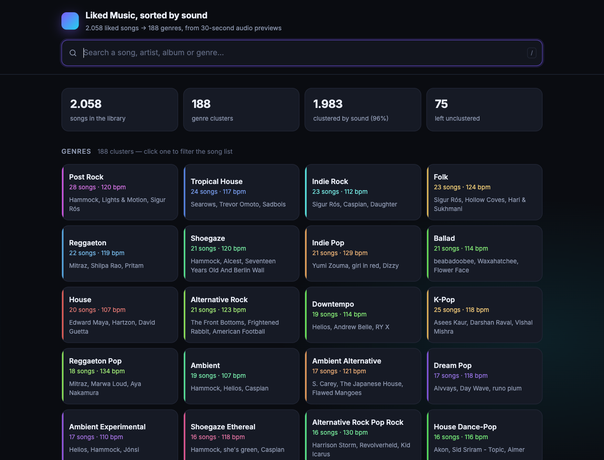

# ytmusic-genre-clusters

Cluster a YouTube Music library by **sound**, not by tags.

Reads your Liked Music playlist, fingerprints each track from a 30-second audio
preview, and groups it into genre clusters you can browse and search in the
browser — then writes the result back as playlists in your own account.

**Live demo:** https://jabezcharles420.github.io/ytmusic-genre-clusters/

> The demo is one real library (2,058 songs → 188 genre clusters). Search a song
> and it tells you which cluster it landed in.



---

## Why this exists

No off-the-shelf app does this. Playlist movers (Soundiiz, TuneMyMusic) only
*transfer* tracks; YouTube Music has no "sort my library by genre" feature, and
its own genre metadata is coarse and often wrong for anything not on a major
label. So this builds the pipeline:

```
Liked Music ──► catalogue match ──► 30s preview ──► audio model ──► clusters
   (API)        (Deezer/iTunes)      (download)     (Discogs-EffNet)   (UMAP +
                                                                       HDBSCAN)
                                                          │
                              ┌───────────────────────────┴────────────────┐
                              ▼                                            ▼
                    private playlists in YT Music            static search site
```

## How the clustering actually works

1. **Fetch** the Liked Music playlist via `ytmusicapi`, authenticating with
   cookies read straight out of the local browser profile (no manual header
   copying).
2. **Match** each track against Deezer (primary: gives BPM + genre labels) and
   iTunes (fallback: gives previews). Matching is a scored comparison of title,
   artist and duration, not naive string equality.
3. **Download** the 30-second previews.
4. **Fingerprint** them with [Essentia](https://essentia.upf.edu/)'s
   Discogs-EffNet model plus the 400-way Discogs style head — 400 genre
   probabilities per track, on CPU.
5. **Cluster** in style space with UMAP → HDBSCAN, merge near-identical
   clusters, snap outliers to the nearest centroid, and place tracks with no
   audio at all by tag similarity.
6. **Name** each cluster by a majority vote of its tracks' own style
   predictions, disambiguated only by co-dominant genres.
7. **Publish** one private playlist per cluster.

### Two things that matter for quality

**Cluster on the style head, not the embedding.** Mean-pooled 1280-d EffNet
embeddings collapse on a real library — 96% of tracks landed in a single
HDBSCAN cluster. The 400-d style probabilities separate genres cleanly.

**Name by vote, not by z-score.** Ranking styles by deviation from the library
mean surfaces near-zero styles as noise: it labelled a Hammock / Sigur Rós
cluster *"sludge metal"*. A majority vote over per-track predictions is faithful.

## Setup

```bash
git clone https://github.com/jabezcharles420/ytmusic-genre-clusters
cd ytmusic-genre-clusters
uv venv .venv && uv pip install -r requirements.txt
```

Requires **Python 3.12+** and `ffmpeg` on PATH.

### Deezer is geo-blocked in some regions

If `api.deezer.com` returns `{"data":[],"total":163}` — an empty result set with
a non-zero total — you are geo-blocked. Tunnel it through any host that isn't:

```bash
ssh -N -D 127.0.0.1:1080 your-host      # SOCKS proxy on 1080
```

`ytmc/util.py` routes `api.deezer.com` and `*.dzcdn.net` through
`socks5h://127.0.0.1:1080` and sends everything else direct. Change `SOCKS` and
`DEEZER_HOSTS` if you use a different proxy. Without a tunnel, matching falls
back to iTunes only — it still works, with slightly lower coverage.

### Last.fm (optional)

Crowd-sourced tags improve cluster names. Grab a free key at
<https://www.last.fm/api/account/create> and either export `LASTFM_API_KEY` or
write it to `data/lastfm.key`. Everything runs without it.

## Usage

```bash
python -m ytmc fetch --authuser 1     # pull Liked Music (browser account index)
python -m ytmc enrich                 # match to Deezer/iTunes
python -m ytmc previews               # download 30s previews
python -m ytmc tags                   # Last.fm tags (optional)
python -m ytmc embed                  # Discogs-EffNet fingerprints
python -m ytmc cluster                # UMAP + HDBSCAN
python -m ytmc report                 # data/clusters.md + clusters.csv
python -m ytmc site                   # docs/data.json for the web UI
python -m ytmc publish                # create playlists in your account
```

Or `python -m ytmc all`. Every stage caches to `data/` and is resumable, so
re-runs only fetch what's new.

**Granularity** — `--min-cluster-size` is the main dial:

```bash
python -m ytmc cluster --min-cluster-size 2   # ~220 clusters
python -m ytmc cluster --min-cluster-size 4   # ~190 (default)
python -m ytmc cluster --min-cluster-size 10  # ~80
```

**Rolling back** playlists this tool created:

```bash
python -m ytmc delete --state data/published.json
```

Only playlist IDs recorded in that state file are ever touched.

## Auth notes

`ytmc/auth.py` reads the browser's cookie store directly: it decrypts the
Chromium `v10` cookie format (AES-128-CBC, key from the login keychain) and
builds a `SAPISIDHASH` authorization header. Two details that bite:

- Cookies must be selected with real RFC 6265 domain matching. Google sets
  session cookies on `.google.com`, `.google.co.in` **and** `.youtube.com`
  separately, and `music.youtube.com` only accepts the `.youtube.com` set.
- With several Google accounts signed in, `--authuser N` picks one. They have
  different libraries; check the count before a long run.

macOS + Chromium-family browsers only. On other platforms, pass a ytmusicapi
headers file instead.

## Web UI

`docs/` is a dependency-free static site (vanilla JS, no build step) served by
GitHub Pages. Search matches titles, artists, albums and genres, with a bounded
fuzzy fallback that tolerates a typo (`shogaze` → `shoegaze`) without matching
scattered letters across a long title.

Clicking a genre opens its own page (`?view=genre&id=…`) with the cluster's
stats, its styles and tags as filters, and its songs — so you don't scroll past
a grid of 188 cards to see results. Back, refresh and deep links all work.

Clusters, styles, Last.fm tags and catalogue genres are all clickable filters.
Select several and they compose: clusters are OR'd within their facet, tags and
genres are OR'd within theirs, and the facets AND together with the search
query. Tags are derived from a song's cluster, so requiring *all* of them would
almost always return nothing — "shoegaze" and "boom bap" never co-occur. State
lives in the URL (`?q=…&cluster=…&tag=…`), so any view is linkable.

## Layout

```
ytmc/          pipeline modules, one per stage
docs/          static site (index.html, app.js, style.css, data.json)
data/          local cache: library, matches, previews, clusters  (gitignored)
models/        Essentia model graphs                              (gitignored)
```

## Privacy

`data/` and `models/` are gitignored. The committed `docs/data.json` **does**
contain the track list of the demo library — that is the point of the demo. If
you fork this for your own library and would rather not publish your listening
history, delete `docs/data.json` before pushing (the site then has nothing to
show) or host it privately.

## License

MIT — see [LICENSE](LICENSE).
